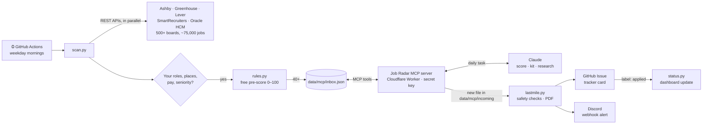

# 📡 Job Radar

**An AI job-matching pipeline that runs on GitHub.** It watches company job boards, filters and pre-scores
every posting for free, and hands only the promising ones to Claude, which scores fit and writes a full
application kit. You get a Discord alert, a tracker card and a one-page tailored resume for each strong match.

> **Everything in this repo is sample data.** The candidate (Jordan Rivera), the companies, jobs, scores and
> research are fictional. Set up your own copy with **[docs/SETUP.md](docs/SETUP.md)**.

## See it

| | |
|---|---|
| 📊 **[Sample dashboard](docs/sample-dashboard.md)** | What your repo's home page becomes: matches, pay, status, pipeline |
| 🗂️ **[Sample tracker card](docs/sample-card.md)** | One strong match: why it fits, tailored resume, answers, cold call, research |
| 📄 **[Sample tailored resume](resumes/)** | One-page PDFs reworded for each job, from [this fictional resume](resume.docx) |
| 🩺 **[Sample health report](data/health/REPORT.md)** | Failures, slowest steps, cost per run, bottleneck hints |

## How it works



- **Free code does the volume.** Fetching, filtering, deduping, a keyword pre-score, PDFs, cards, alerts
  and the dashboard all run in GitHub Actions at no cost.
- **AI does the judgment.** Only jobs that pass the rules reach Claude. Through Job Radar's own
  **[MCP server](docs/MCP_SERVER.md)** (TypeScript on Cloudflare Workers, 9 tools), a daily Claude task
  scores fit against the resume and preferences and writes each strong match's kit. There's no API bill;
  `ai.mode: api` (pay per use) and `rules` (no AI) are also supported.
- **Every AI answer is checked.** Submissions are validated before anything changes. Resume rewrites can't
  add numbers, tools or experience that aren't already on the resume, and links must be `https://`.
- **Built for volume.** It reads hundreds of job boards in parallel (about 75,000 postings in 3–4 minutes)
  and keeps only the titles you want in memory. A board finder workflow checks hundreds of company names
  at once and reports which ones have open jobs.
- **Every match gets a card at the right depth.** Score 7+: tailored resume and full kit. Score 6: a card
  with the standard resume, ready to apply. Lower: one tap moves it to Active.
- **One-tap tracking.** Each dashboard row has signed Move links (Applied, Interviewing, Offer, Rejected,
  Skip, back to Active) served by the MCP server, plus a batch page to move many jobs at once. Each link
  can only do the one move it was made for.
- **Ready for long application forms.** Every card splits the resume it uses into each job's title, dates
  and description, plus skills and certifications, for Workday-style forms.
- **It watches itself.** Every run logs its timing, Claude cost and errors. Crashes send a Discord alert
  and open an issue, and the [health report](data/health/REPORT.md) points at bottlenecks.

More detail: **[docs/HOW_IT_WORKS.md](docs/HOW_IT_WORKS.md)**.

## What's inside

| Path | What it is |
|---|---|
| `jobradar/` | The pipeline (Python): sources, filters, rules, scan, last mile, tailoring, alerts, health |
| `mcp-server/` | The MCP server (TypeScript, Cloudflare Workers): JSON-RPC over Streamable HTTP, secret-key auth |
| `.github/workflows/` | Scan, apply Claude's work, status updates, Move links, batch moves, add a job, quiz, board finder, deploy, tests, reset |
| `.github/ISSUE_TEMPLATE/` | The preferences quiz and "Add a job" forms |
| `tests/`, `mcp-server/test/` | 135 tests: 108 for the pipeline, 27 for the server. Nothing real is called. |

```bash
pip install -r requirements.txt pytest && pytest -q
cd mcp-server && npm ci && npm test
```

## Set up your own

Follow **[docs/SETUP.md](docs/SETUP.md)**: copy the repo (private), add your resume and companies, take
the quiz, connect Discord, and pick an AI mode. About 30–45 minutes. Nothing here is connected to anyone
else's accounts; your copy uses only the keys you add.

## License

MIT. Built by [@atrolio02](https://github.com/atrolio02).
