# How Job Radar works

Job Radar finds sales engineering jobs that fit your resume **and** your preferences, scores them with AI,
alerts you on Discord, builds a copy-paste application kit, and tracks every application, all running on GitHub.

Free code does everything it can: fetching, filtering, a rules-based pre-score, dedupe, PDFs, cards, alerts.
Claude only does the **last mile** (judging fit, writing kits, research), through Job Radar's own
**MCP server** and a daily Claude task, so there's no API bill. See [MCP_SERVER.md](MCP_SERVER.md).

```mermaid
flowchart LR
  quiz["📝 Preferences quiz<br/>(issue form)"] -. "webhook event" .-> prefs["preferences.py<br/>saves profile.yml"] --> scan
  add["➕ Add a job form<br/>(LinkedIn, Indeed, referrals)"] -. "webhook event" .-> addjob["addjob.py"] --> claude
  cron["⏰ GitHub Actions<br/>weekday schedule"] --> scan["scan.py"]
  scan -- "API calls (GET)" --> boards["Ashby · Greenhouse · Lever<br/>public job board APIs"]
  scan -- "rules: title, location, age" --> filt{"Matches?"}
  filt -- yes --> pre["rules.py<br/>free pre-score 0–100"]
  pre -- "40+" --> inbox[("data/mcp/inbox.json")]
  inbox <-- "MCP tools" --> mcp["Job Radar MCP server<br/>(Cloudflare Worker, secret key)"]
  mcp <-- "daily Claude task" --> claude["Claude<br/>score 1–10 · kits · research"]
  mcp -- "new file in data/mcp/incoming" --> apply["lastmile.py<br/>safety checks, PDF"]
  apply --> issue["GitHub REST API<br/>open tracker card (Issue)"]
  apply --> discord["Outgoing webhook<br/>Discord alert"]
  issue -. "you add a label or<br/>comment /applied" .-> hook["Incoming webhook event<br/>(issues / issue_comment)"]
  hook --> status["status.py"] --> discord
  scan --> store[("data/jobs.json<br/>+ README dashboard")]
  status --> store
```

## The pieces, in plain English

| Piece | What it does | Type |
|---|---|---|
| **Job board APIs** | Ashby, Greenhouse and Lever publish each company's open jobs at a public web address for careers pages. The scan asks each one for its list. | Outgoing API calls (GET) |
| **Preferences quiz** | A GitHub form: work arrangement, locations, relocation, pay, roles, seniority, company size, industries, travel, work authorization, deal-breakers, dream companies. Submitting it saves `profile.yml` and starts a fresh scan. | Incoming webhook |
| **Rules filter** | Keeps only your roles and seniority, the work arrangements and places you picked, pay that isn't below your floor, and recent postings. | Python |
| **Rules pre-score** | Scores each match 0–100 for free: skills your resume shares with the posting, title fit, pay, work arrangement, freshness, minus deal-breakers. Only jobs at 40+ reach Claude. | Python |
| **MCP server** | Job Radar's own connector for Claude: 9 tools to read the inbox, submit scores and kits, list and update cards, read the health report and start a scan. Locked with a secret key. | Cloudflare Worker (TypeScript) |
| **Claude (last mile)** | A daily Claude task scores each new match 1–10 against `resume.docx` and your preferences. Strong matches get an application kit, tailored bullets, a 30-second cold call and a LinkedIn note. It is told never to invent experience. Set `ai.mode: api` to use the Claude API instead, or `rules` for no AI. | MCP tools |
| **Application kit** | Copy-paste answers on each card: your standard fields, "why this company," salary answer, and answers to the form's custom questions (Greenhouse publishes these). You review and submit; nothing is sent for you. | Generated |
| **Tailored resume** | For each strong match, Claude rewords your summary and up to 6 of the most relevant bullets to mirror the posting. A safety check throws out any rewrite that adds a number not on your real resume or runs long. The changes go into a copy of `resume.docx`, so your formatting stays identical, and it's saved as a one-page PDF and Word file in `resumes/`, linked on the card and attached to the Discord alert. Every version is tagged and kept in a library (`resumes/README.md`): when a new job has the same role type and mostly the same tags, that version is reused at no AI cost, and the card gets its `resume-` label. Files never include a company name. | Claude API + LibreOffice |
| **Company snapshot** | For each strong match, Claude uses web search to find the company's employee rating, CEO approval, common pros and cons, recent Reddit and X threads, and red flags like layoffs or leadership changes, citing its sources. Saved per company for 30 days. Every card also links to the company's Glassdoor, Indeed, LinkedIn, Reddit and X results. Glassdoor has no public API and bans scraping, so nothing is scraped. | Claude API with web search tool |
| **Add a job form** | Paste any job you find (LinkedIn, Indeed, a referral). It's scored and gets the same card, kit and alert. | Incoming webhook |
| **GitHub REST API** | Opens a tracker card (a GitHub Issue) for each strong match. | Outgoing API calls (POST) |
| **Discord webhook** | Sends alerts, status changes and run summaries to your Discord channel. | Outgoing webhook |
| **GitHub webhook events** | When you label, comment on, close or reopen a card, GitHub fires an event that starts `status.py`. | Incoming webhook |
| **GitHub Actions** | Runs the scan on a schedule, reacts to webhook events and runs the tests. No server to manage. | Scheduling and automation |
| **data/jobs.json + README** | The tracker's memory and your dashboard, saved back into the repo after every change. | Storage |

## Using it day to day

- **First:** take the **Job preferences quiz** (Issues → New issue). Retake it whenever your plans change;
  jobs that weren't alerted yet get re-scored against the new answers.
- **Found a job elsewhere?** Issues → New issue → **Add a job**, paste the link and description.
- **Applying:** open the card, download the tailored resume PDF, copy the application kit into the form, read every answer, submit.

- **Alerts:** strong matches show up in Discord around 7:15 a.m. on weekdays.
- **Dashboard:** this repo's home page. It shows every strong match by status, plus lower-scoring jobs.
- **Update a job:** open its card and add a label (`applied`, `interviewing`, `offer`, `rejected`, `skip`)
  or comment `/applied`, `/interviewing`, `/offer`, `/rejected` or `/skip`. Close a card to file it away.
- **Run it now:** Actions tab → **Daily job scan** → **Run workflow**.
- **Change what it looks for:** retake the quiz. `config.yml` holds the company list, always-skip titles and the score cutoff.
- **New resume:** upload your new Word file as `resume.docx` (replace the old one). Scoring and tailoring use it from the next run.

### Adding a company

Easiest: paste a link to any of the company's job postings into the quiz's **Dream companies** box.
Or add it to `config.yml` yourself. Open the company's careers page and click a job; the address tells you the system and name:

- `jobs.ashbyhq.com/Northwind/...` → add `Northwind` under `ashby:`
- `boards.greenhouse.io/example-co/...` or `job-boards.greenhouse.io/example-co/...` → add `example-co` under `greenhouse:`
- `jobs.lever.co/example-co/...` → add `example-co` under `lever:`

Companies using other systems (Workday, iCIMS and so on) aren't supported yet; use **Add a job** for those.

### Why there's no LinkedIn or Indeed scraping

Both ban scraping in their terms, and LinkedIn restricts accounts it catches. Your LinkedIn is a work tool,
so Job Radar stays on official, public APIs. Many LinkedIn and Indeed postings come from companies on Ashby,
Greenhouse or Lever anyway: add them as dream companies, and paste anything else into **Add a job**.
If a name is wrong, the run summary and Discord tell you which one.

## One-time setup

Follow **[SETUP.md](SETUP.md)**: copy the repo, add your resume and companies, connect Discord, take the quiz,
and pick an AI mode.

## Health: the error tracker and efficiency log

Every run (the daily scan, a status change, an added job, the quiz) records how it went:

- **Where the time goes.** Each step is timed (fetching, scoring, building cards, tailoring the resume,
  making the PDF), as is every web request to the job boards, the Claude API, GitHub and Discord.
- **What it costs.** Claude reports the tokens it used on every call. Job Radar turns them into dollars
  (prices are in `jobradar/telemetry.py`; to change them, add `health: prices:` to config.yml).
- **What went wrong.** Warnings (a board that couldn't be reached, a resume that couldn't be made) and
  crashes, each with a short id so repeats are grouped.

Each run saves one file in `data/health/runs/` (kept for 90 days), and `data/health/REPORT.md` is rebuilt
with the last 30 days: failures, the slowest steps, cost per run and per strong match, the slowest job
boards, grouped errors, and plain-language **bottleneck hints**.

**Alerts, so nothing fails silently:**

| What happens | What you get |
|---|---|
| A run crashes | A Discord alert and a GitHub Issue labeled `radar-error`. If the same crash happens again, it adds a comment instead of a new issue. |
| A step outside Job Radar's code fails (install, save) | The workflow's last step sends the same alert and still saves the health log. |
| The same warning shows up 3 runs in a row | One alert, then weekly while it continues. |
| Something looks off but didn't error (0 jobs fetched, a board suddenly empty, a run 2.5x slower or 3x pricier than usual, every Claude call failing) | Logged as an "Unusual:" warning and shown in the run summary. |

Close a `radar-error` issue once it's fixed. To see the report any time, open `data/health/REPORT.md`
on GitHub. To check-in with Claude, connect the repo and ask it to analyze `data/health/`.

## Cost

Built to cost nothing beyond your Claude subscription:

- **GitHub Actions:** the scan, cards, PDFs and alerts run within GitHub's free monthly minutes for private repos.
- **Cloudflare Workers:** the MCP server handles a few dozen requests a day; the free plan allows far more.
- **Claude:** works through your subscription via the MCP server, so there's no API bill.

And Claude's time is spent only where it matters:

- **Rules first:** only jobs that match your roles, places and pay floor *and* score 40+ on the free
  pre-score reach Claude (`rules_min_score`).
- **Short postings for scoring:** boilerplate is cut and Claude scores from the first 2,500 characters;
  only strong matches get the full posting.
- **Repeat postings scored once:** the same role in five cities is one score and one card.
- **Reuse:** company research is reused for 30 days, and a tailored resume is reused for similar jobs.
- **Caps:** 40 jobs and 15 full workups a day (`max_jobs_scored_per_run`, `max_cards_per_run`).
- **Never stuck:** if Claude misses a day, jobs wait in the inbox; a strong match whose kit doesn't come
  within 30 hours gets its card and alert anyway, and the health log warns after 3 days.

## Explaining it in an interview

> "I built a job-search pipeline on GitHub Actions. On a schedule it calls the Ashby, Greenhouse and Lever
> APIs, filters postings by my preferences, and pre-scores them with plain rules so AI only sees the
> promising ones. Then I built an MCP server, a Cloudflare Worker in TypeScript, that exposes the
> pipeline to Claude as tools. A daily Claude task pulls the queue, scores each job against my resume,
> and writes the application kit. Its submissions land in the repo, which triggers a workflow that
> safety-checks them, builds a tailored resume PDF, opens a GitHub Issue through the REST API and posts
> to Discord through a webhook. When I update a card, a webhook event updates the dashboard. It's the
> same pattern as a GTM workflow: pull data from APIs, enrich and score it with AI, route it to the right
> place, and react to events. Deterministic code does the volume; AI does the judgment."
